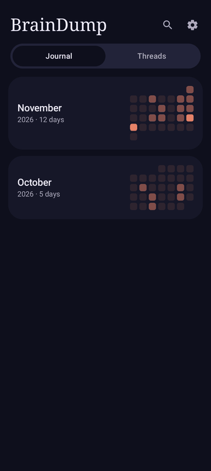
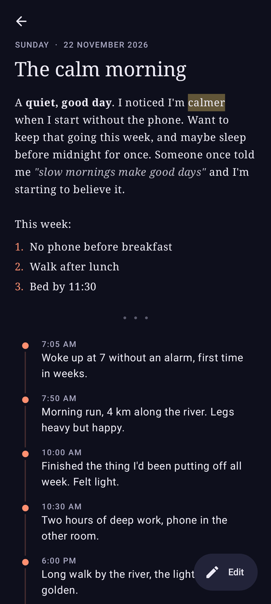
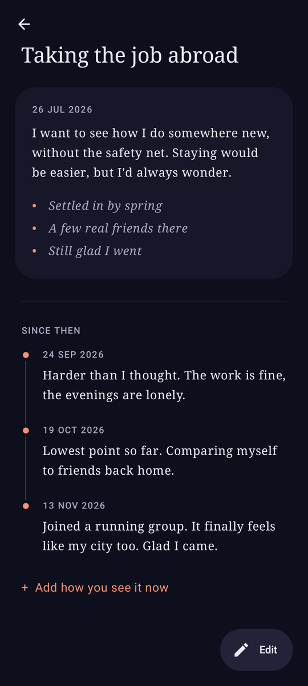
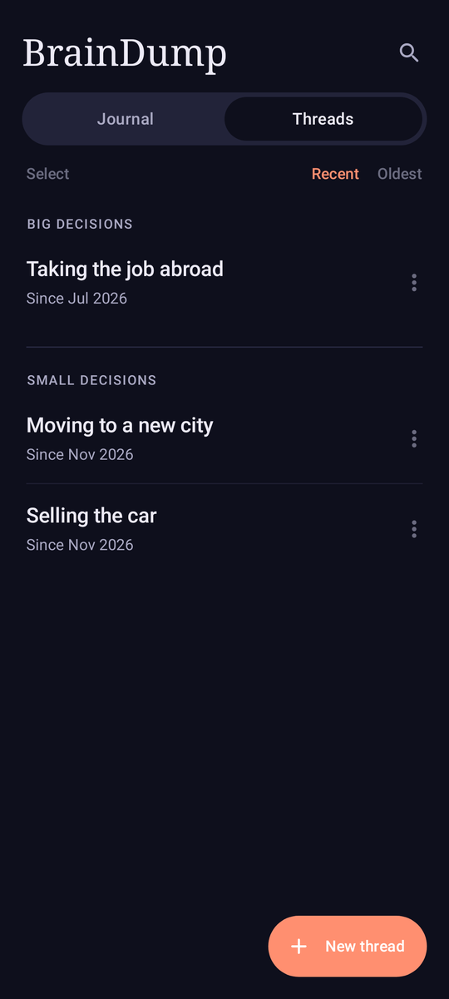

# BrainDump

A journal for people who mean to write every day, and don't.

  

## Why I made this

I kept a journal for years. Most days I didn't write in it, and it wasn't because I had nothing to say. Opening it felt like a chore, and the blank page felt like homework. By night the day was a blur.

So I made the app I wished I had:

- **It comes to you.** A gentle reminder asks what you've been up to, and you can answer right from the notification. Every reminder counts from the last time you wrote, so it never nags.
- **Small is enough.** One line about what happened is a real entry. Write the longer version at night if you feel like it.
- **It stays yours.** No account, no cloud, no internet permission at all. Your words never leave your phone unless you export them.

## What's inside

**Journal.** Each day has two halves: a timeline of small moments, and a write-up you can read like a blog post. Put photos anywhere in the text, add lists, and use bold, italic or highlight when a line matters.

**Threads.** For big and small decisions. Write down why you chose something and what you expect. Come back months later and add how you see it now. The app reminds you when it's time.

  
  
  

Plus: search, dark mode, an app lock (fingerprint, face or PIN), a text size you can pinch to change, and export to a zip you can share or save.

## Download

**[Download the latest APK](../../releases/download/latest/braindump.apk)** (Android 10 or newer).

Open it on your phone and tap Install. You might see:

- **"Install unknown apps"**: allow it for your browser or file manager, just this once.
- **A Play Protect warning**: the app isn't on the Play Store, so Google doesn't know it. Tap *More details → Install anyway*.
- **No reminders showing up**: let BrainDump send notifications. Some phones also put apps to sleep to save battery, so set BrainDump's battery use to *Unrestricted*.
- **App lock is greyed out**: set a screen lock on your phone first.

To update, install the new APK over the old one. Your entries stay.

## Your data

Everything lives inside the app on your phone. If you uninstall the app, your entries are gone too, so use **Settings → Export** now and then to keep a copy.
